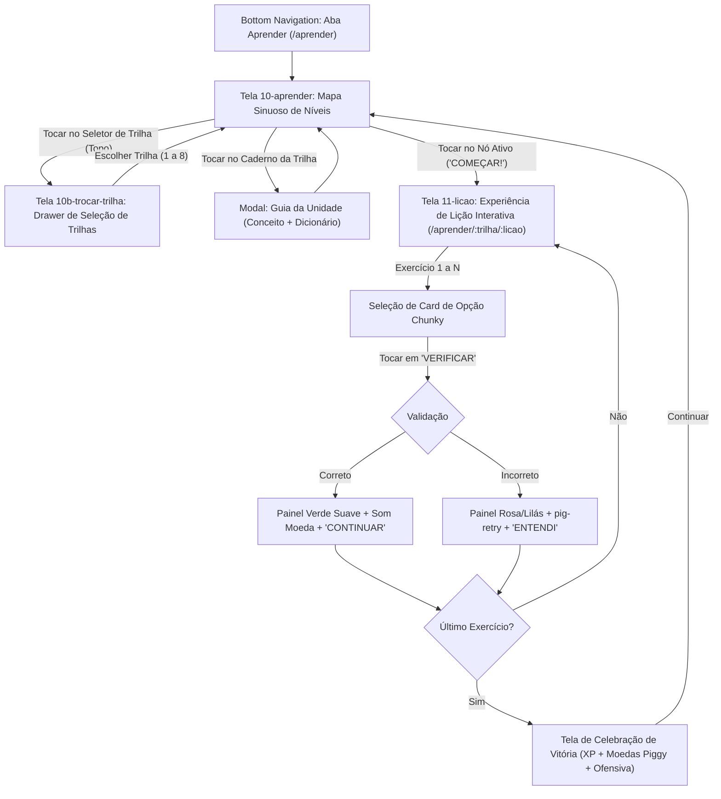

# Especificação do Módulo Desafio Piggy (Aprender Gamificado)

> **Documento Canônico de Arquitetura, Layout e Design Gamificado**  
> **Status:** Especificação Oficial Atualizada (Prompt N3B)  
> **Exceção Autorizada:** Conforme `AGENTS.md`, o módulo **Desafio Piggy** adota tanto a **estrutura/mecânica** quanto o **layout visual** inspirados no padrão Duolingo (`design/referencias/duolingo-ui.jpg`), substituindo integralmente as antigas telas 11 e 12 do layout original pelos novos mockups aprovados em `design/telas-extra/` (`10-aprender.png`, `10b-trocar-trilha.png` e `11-licao.png`).  
> **Identidade Intacta:** Cores, tokens (`design/tokens.md`), tipografia Nunito, mascote oficial aprovado (`mascotes/manifest.json`), redação sem economês e tom de voz acolhedor permanecem **100% PurplePiggy**. Proibido copiar mascotes, cores verdes/azuis padrão ou elementos visuais do Duolingo.

---

## 1. Visão Geral e Princípios Fundamentais

O **Desafio Piggy** transforma a educação financeira — frequentemente sentida como intimidadora, punitiva ou cheia de termos difíceis — em uma experiência diária alegre, visualmente irresistível e estruturada em hábitos consistentes.

### Princípios Inegociáveis:
1. **Layout & Física Chunky com Paleta PurplePiggy:** A interface adota botões táteis tridimensionais (efeito "chunky", com bisel inferior de 4px que afunda ao toque), cards com relevo suave, caminhos de nós em zigue-zague e drawers de validação no rodapé, vestidos integralmente com roxo degradê (`#7D2BD6` a `#B037F8`), lilases translúcidos (`#F8F5FC`, `#EEDEFB`), branco vidro e detalhes dourados (`#F5B83D`).
2. **Pedagogia Sem Culpa:** O app jamais humilha ou pune a usuária. Respostas erradas não quebram o dia nem bloqueiam o acesso: acionam o mascote `pig-retry` com um balão explicativo carinhoso e reinserem a questão no fim da lição para fixação natural.
3. **Microdoses de 2 a 3 Minutos:** Cada lição é composta por 4 a 6 interações ativas rápidas, finalizando com resumo prático acionável no próprio app.
4. **Sem Emojis na Interface:** Ícones de interface usam SVGs canônicos ou assets homologados (`coin-1`, `sparkle`, `heart-filled`), respeitando rigorosamente o `AGENTS.md`.

---

## 2. Fluxo Completo de Navegação (Substituição das Telas 11 e 12)

As telas 11 e 12 deixam de ser listas estáticas e passam a constituir o fluxo gamificado principal:

### Detalhamento das 3 Telas do Módulo:
1. **`10-aprender.png` (Tela 11 — Mapa Sinuoso):**
   - **Header de Status Fixo:** Seletor de Trilha com dropdown, contador de Ofensiva (dias de streak com fogo), saldo de Moedas Piggy e Vidas/Corações.
   - **Banner da Unidade Atual:** Card com título da unidade, descrição de foco e botão para abrir o Caderno da Unidade.
   - **Trilha Sinuosa:** Caminho em curvas suaves interligando nós circulares 3D, decorados com moedas, baús e o mascote oficial em posições dinâmicas.
2. **`10b-trocar-trilha.png` (Drawer de Troca de Trilhas):**
   - Gaveta modal deslizante a partir da base exibindo as **8 Trilhas Oficiais** do PurplePiggy.
   - Cada card de trilha exibe: ícone temático (`<CategoryIcon>`), título (ex: *"TRILHA 01: Organização Financeira"*), barra de progresso individual, porcentagem concluída e estado (em andamento, concluída ou disponível).
3. **`11-licao.png` (Tela 12 — Lição Gamificada):**
   - Topo com botão fechar `X`, barra de progresso contínua (pílula horizontal que enche a cada acerto) e corações.
   - Área central: Mascote oficial com dica (`pig-idea`), pergunta ou situação do cotidiano e cards interativos de opção.
   - Rodapé: Botão de ação largo em estado desabilitado/habilitado que se transforma no **Painel de Feedback Fixo** após o clique.

---

## 3. Direção de Layout (Estilo Duolingo com Visual PurplePiggy)

### 3.1. Botões Chunky (Física Tátil 3D)
Os botões do módulo utilizam uma base com bisel tridimensional de 4px que afunda realisticamente sob pressão do dedo:
- **Estrutura:** `border-b-[4px]` no estado padrão; ao pressionar (`:active`), aplica `translate-y-[2px]` e `border-b-[2px]`, transmitindo peso físico e recompensa mecânica instantânea.
- **Variantes de Cores:**
  - **Primário (Roxo Piggy):** Fundo em degradê roxo canônico (`#7D2BD6` a `#8E2DE2`), bisel inferior em roxo profundo (`#5B21B6`), texto branco bold.
  - **Sucesso (Avançar / Continuar):** Fundo verde positivo (`#2FBF71`), bisel inferior verde floresta (`#1E824C`), texto branco bold.
  - **Desabilitado:** Fundo cinza-lilás claro (`#E8DEFB`), bisel inferior `#D8C2FF`, texto `#9CA3AF`, sem deslocamento ao toque.
  - **Secundário / Neutro:** Fundo branco, contorno de 2px lilás `#E8DEFB`, bisel inferior `#D8C2FF`, texto roxo `#432171`.

### 3.2. Cards de Opção Interativos (Seleção de Respostas)
- **Estado Padrão (Repouso):**
  - Fundo branco (`bg-white`), cantos bem arredondados (`rounded-2xl` / 16px), borda perimetral de 2px (`border-[#E8DEFB]`), bisel 3D inferior (`border-b-[4px] border-[#D8C2FF]`).
  - Tipografia: Nunito 700 (Bold), cor `#432171` (deep).
  - Indicador à esquerda: pílula/círculo com letra (A, B, C) ou número em cinza-lilás.
- **Estado Selecionado:**
  - Borda perimetral roxa vibrante (`border-[#7D2BD6]`), bisel inferior em roxo escuro (`border-b-[4px] border-[#5B21B6]`), fundo sutilmente lilás translúcido (`bg-[#F6EEFF]`).
  - Indicador circular preenche em roxo com letra/check em branco.
- **Estado de Validação (Correto):**
  - Borda perimetral verde (`border-[#2FBF71]`), bisel inferior `#1E824C`, fundo verde suave (`bg-[#DCFCE7]`), texto `#15803D`.
- **Estado de Validação (Incorreto):**
  - Borda perimetral rosa-magenta (`border-[#E5487A]`), bisel inferior `#BE185D`, fundo rosa suave (`bg-[#FCE7F3]`), texto `#BE185D`.

### 3.3. Painel de Feedback Fixo no Rodapé (Drawer de Validação)
Substitui alerts ou toasts soltos por uma gaveta inferior integrada à física da tela:
- **Painel de Acerto:**
  - Fundo verde claro acolhedor (`#DCFCE7`), borda superior fina `#86EFAC`.
  - Cabeçalho: Ícone circular verde com check branco + texto *"Excelente!", "Mandou muito bem!"* (Nunito ExtraBold, `#15803D`).
  - Mascote: `pig-success` celebrando com carimbo de check em formato de coração.
  - Botão de ação: Botão chunky verde largo *"CONTINUAR"*.
- **Painel de Erro Construtivo:**
  - Fundo rosa suave (`#FCE7F3`), borda superior fina `#F472B6`.
  - Cabeçalho: Ícone circular informativo + texto *"Quase lá! Resposta correta:"* (Nunito ExtraBold, `#BE185D`).
  - Explicação didática curta em Nunito SemiBold, sem termos técnicos frios.
  - Mascote: `pig-retry` com expressão de encorajamento ("Não desanime, você pega o jeito!").
  - Botão de ação: Botão chunky roxo largo *"ENTENDI"*.

### 3.4. Barra de Topo da Lição (Top Bar)
- Botão fechar `X` em cinza-lilás suave à esquerda com confirmação de saída não punitiva.
- Barra de progresso contínua pílula: trilho `#F0E7FA`, preenchimento em degradê roxo `#7D2BD6` $\to$ `#B037F8` que estica com animação de elasticidade suave.
- Indicador de 3 corações roxos (`heart-filled` de `public/assets/decorations/`).

### 3.5. Nós do Mapa Sinuoso (Trilha de Aprendizado)
- Círculos de 70px de diâmetro dispostos em zigue-zague suave sobre um trilho lilás (`#EADFFB`).
- **Nó Concluído:** Círculo roxo com bisel inferior 3D em `#5B21B6`, check branco centralizado e 3 estrelas douradas de maestria em cima.
- **Nó Ativo:** Círculo com pulso suave (`animate-pulseGlow`), balão flutuante apontando para baixo *"COMEÇAR!"*, mascote `pig-welcome` apoiado ao lado acenando.
- **Nó Bloqueado:** Fundo lilás claro translúcido com cadeado roxo discreto.
- **Nó Baú de Tesouro:** Porquinho-cofre dourado com laço lilás que entrega 50 moedas Piggy ao ser desbloqueado.

---

## 4. Tipologia dos Exercícios Interativos

As lições contam com 5 modalidades pedagógicas:

1. **Múltipla Escolha Rápida:** Cards chunky com 3 ou 4 alternativas para conceitos centrais.
2. **Cenário Real do Cotidiano:** Uma mini-situação financeira em card de vidro + 2 botões contrastantes chunky (*"Com certeza!"* vs *"Melhor esperar"*).
3. **Ordenação de Prioridades:** Cards táteis arrastáveis ou clicáveis para organizar sequências (ex: Reserva $\to$ Contas Fixas $\to$ Lazer).
4. **Pareamento de Conceitos:** Duas colunas interativas onde a usuária toca em um termo e depois no seu significado prático, conectando-os com uma linha lilás.
5. **Preenchimento de Lacunas:** Texto com espaço vazio completado pelo toque em chips pílula (`Chip variant="filter"`).

---

## 5. Ofensiva Piggy (Streak) e Economia de Moedas

1. **Ofensiva Diária (Streak):**
   - Contador com fogo estilizado no topo do mapa.
   - Lição concluída no dia acende o fogo dourado/roxo e incrementa a contagem.
   - Recuperação / Congelamento de Ofensiva via moedas Piggy acumuladas (sem paywall).
2. **Moedas Piggy:**
   - Ganhas a cada lição concluída (+10 moedas) ou baú aberto (+50 moedas).
   - Utilizadas para desbloquear itens cosméticos do mascote e escudos de proteção de ofensiva.
3. **Marcos de Celebração:**
   - 3 dias: Mascote `pig-deposit`.
   - 7 dias: Mascote `pig-medal`.
   - 14 dias: Mascote `pig-trophy`.
   - Conclusão da trilha (todas as unidades): Mascote `pig-graduate` com diploma.

---

## 6. Mapeamento Estrito dos Mascotes por Momento

| Momento | Mascote | Arquivo de Asset | Papel Visual |
| :--- | :--- | :--- | :--- |
| **Boas-Vindas no Mapa** | `pig-welcome` | `/assets/mascot/pig-welcome.png` | Apoiado no nó ativo acenando |
| **Dica no Enunciado** | `pig-idea` | `/assets/mascot/pig-idea.png` | Lâmpada de insight acesa |
| **Acerto no Exercício** | `pig-success` | `/assets/mascot/pig-success.png` | No drawer verde de sucesso |
| **Erro Construtivo** | `pig-retry` | `/assets/mascot/pig-retry.png` | No drawer rosa explicando |
| **Carregamento / Sincronia** | `pig-loading` | `/assets/mascot/pig-loading.png` | Moeda dourada girando |
| **Subida de Nível / Troféu** | `pig-trophy` | `/assets/mascot/pig-trophy.png` | Conquista de unidade |
| **Formatura de Trilha** | `pig-graduate` | `/assets/mascot/pig-graduate.png` | Conclusão das 8 trilhas |
| **Marco de Ofensiva** | `pig-medal` | `/assets/mascot/pig-medal.png` | Streak de 7/14 dias |

---

## 7. Caderno da Trilha (Guia de Unidade)

Acessível pelo cabeçalho da unidade no mapa:
- **Conceito Chave:** Explicação em menos de 1 minuto em linguagem humana.
- **Dicionário Descomplicado:** Tradução de termos financeiros complexos para o cotidiano.
- **Ação Prática:** Botão direto para executar o aprendizado nas abas do app (Metas, Gastos ou Orçamento).

---

## 8. Acessibilidade

- Leitores de tela com `aria-live` e descrições sem dependência de cor.
- Suporte a `prefers-reduced-motion` desabilitando tremores e pulsações 3D.
- Contraste WCAG AAA em todos os textos dos cards chunky e drawers.
